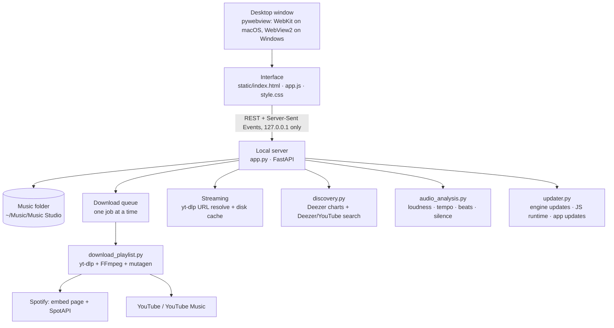
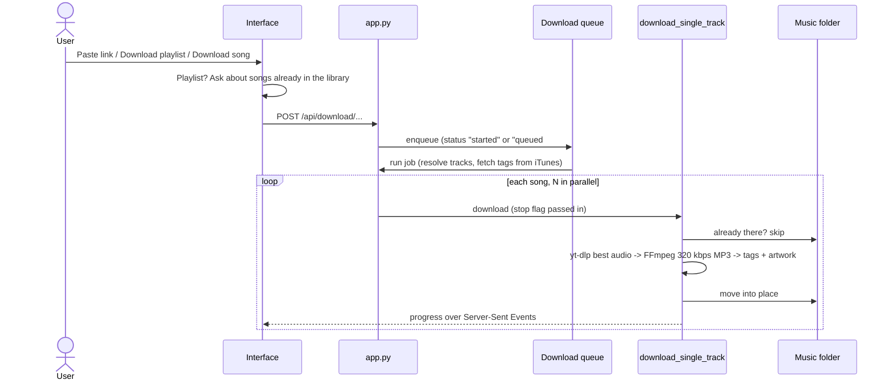
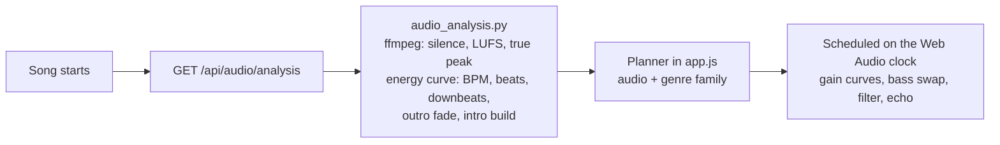

# Architecture

Music Studio is a desktop app made of a local Python server and a web interface shown in a native
window. Everything runs on the user's machine; the server only accepts connections from the machine itself.

## 1. Overview

| Layer | Technology | Notes |
| :--- | :--- | :--- |
| Desktop shell | pywebview | Persistent web storage, so settings, queue and last song survive restarts |
| Server | FastAPI + Uvicorn | Binds to `127.0.0.1`; rejects requests whose `Host` is not local (DNS rebinding) |
| Interface | HTML, CSS, vanilla JavaScript | No build step; asset URLs carry a content hash so the window never runs stale code |
| Audio | Two `<audio>` decks routed through Web Audio | Gain envelopes, EQ and echo are scheduled on the audio clock |
| Download engine | yt-dlp, FFmpeg, mutagen | 320 kbps MP3, ID3 tags and 1000×1000 artwork |
| Packaging | PyInstaller, NSIS, GitHub Actions | Single executable; no Python or FFmpeg needed on the user's machine |

## 2. Downloads

- **Queue**: jobs share one progress display, so they run one after another. *Stop* cancels the songs
  that have not started, aborts running ones through a yt-dlp progress hook, and clears the queue.
- **Spotify**: single songs come from the public embed page; full playlists and albums from SpotAPI.
  Each Spotify song is then found on YouTube and downloaded from there.
- **Temp files**: each song writes `.temp_<id>.*` files and only ever removes its own.

## 3. Self-repair (`updater.py`)

YouTube and Spotify change often, and a frozen app cannot be patched by `pip`. The updater keeps a
user-writable folder (`~/.musicstudio/pkgs`) ahead of the bundled packages on `sys.path`.

| Situation | Action |
| :--- | :--- |
| App starts | Update yt-dlp in the background if PyPI has a newer version; fetch QuickJS if no deno/node/bun is installed |
| A download, stream or playlist read fails with an extraction error (403, sign-in check, signature) | `heal()`: update yt-dlp, make sure a JS runtime exists, retry once (at most every 30 minutes) |
| A Spotify playlist/album read fails | Update SpotAPI; roll back if the new copy does not import |
| A stream URL is refused (HTTP 403) | Resolve a fresh URL once |

Wheels are verified against PyPI's SHA-256; QuickJS binaries are pinned by SHA-256.

App updates: the app follows `github.com/<repo>/releases/latest` (no API rate limit), compares the tag
with its own version, and shows a banner plus a *Download* button in **Settings → App Updates**.
CI stamps the tag's version into the build (`scripts/stamp_version.py`).

## 4. Smart Transition

Analysis (cached per file, about one second per song) uses ffmpeg and the standard library only:
silence at both ends, integrated loudness and true peak (EBU R128), tempo from kick/hat onsets with
harmonic scoring, a beat grid with downbeats for the ending, and how long the outro fades and the intro builds.

| Situation | Transition |
| :--- | :--- |
| Next song is the next track of the same album | Gapless |
| Outgoing song fades out by itself (≥ 4 s) | Natural fade: the next song rises under that fade, starting on a downbeat |
| Very different genres (e.g. hip-hop → country) or clashing tempos | Echo out: the last downbeat plays, its beat echoes in tempo, the next song drops in on the following beat |
| Ambient, classical, jazz, lo-fi | Slow dissolve with the outgoing highs rolled off |
| Electronic → electronic | Filter sweep with a bass swap |
| Anything else that fits | Equal-power blend over 16 beats (8 if tempos differ), bass swap on a bar line |
| Listener presses Next | Quick 0.9 s blend |

Silence at the start and end of songs is skipped, the incoming song is cued to its first beat, and
levels are matched to −12 LUFS. Transitions are scheduled up to a second ahead on the audio clock, so
they land on the beat and keep running while the window is minimised.

## 5. Library and playback

- The library list is the full sorted library; the search box only narrows what is shown, so the song
  number, metadata and *Next* always refer to the same song.
- Each player deck remembers which song it holds; transitions are planned from the deck that is
  actually playing.
- Queue, shuffle order (including online lists) and *Up next* stay consistent: the queue drawer, the
  full-screen *Up next* and the next song played are all derived from the same function.

## 6. Packaging and release

| Platform | Build | Output |
| :--- | :--- | :--- |
| macOS | `package_dmg.sh` (PyInstaller `music_studio.spec`) | `MusicStudio-Installer.dmg` |
| Windows | PyInstaller `windows_app.spec` + NSIS `installer/MusicStudio_Installer.nsi` | `MusicStudio-Setup.exe`, `MusicStudio.exe` |
| Release | `.github/workflows/build_releases.yml` on a `v*` tag | GitHub release with both installers |

On Windows the app sets its AppUserModelID and taskbar relaunch properties so a pinned taskbar icon
shows Music Studio rather than a generic executable.
